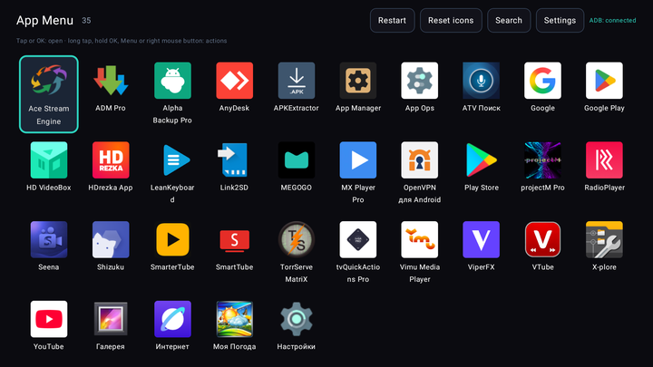
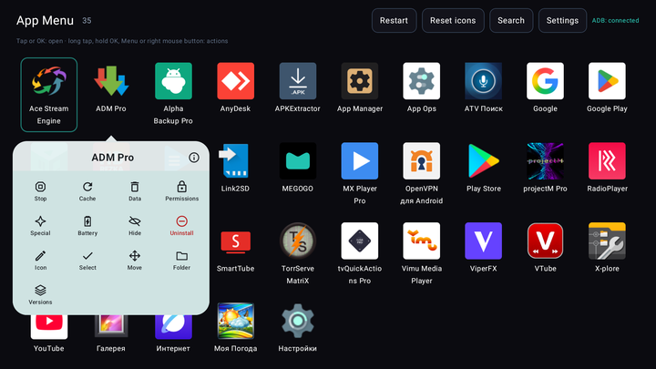
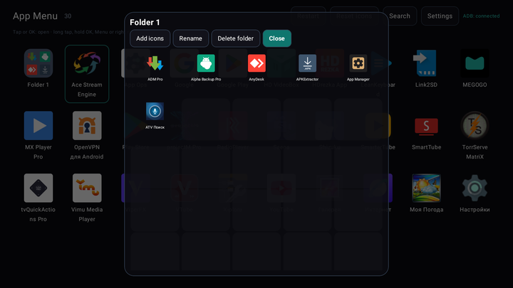
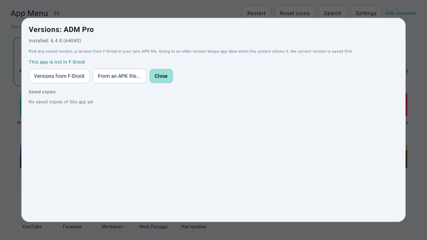
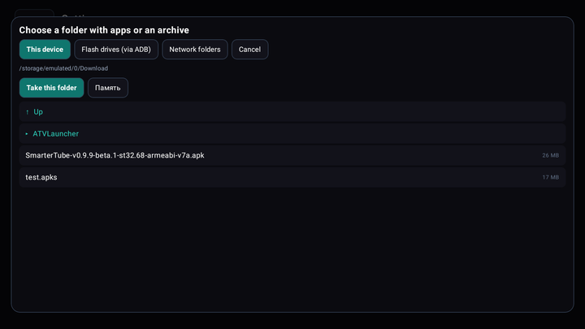
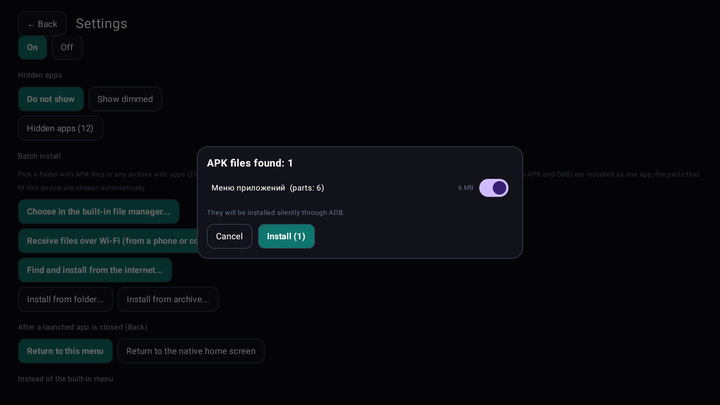
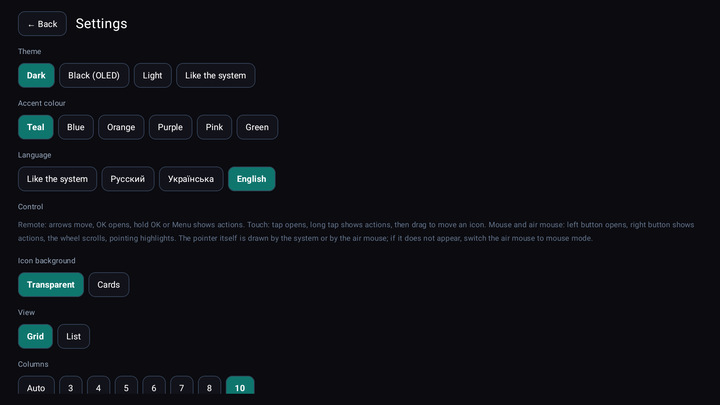
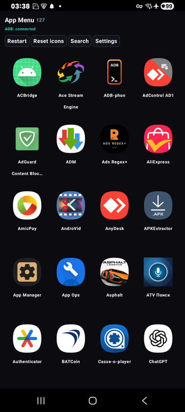
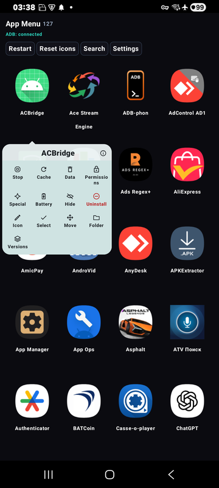

[English](README.md) · [Русский](README.ru.md) · [Українська](README.uk.md)

🌐 All our programs: https://drugoj00.github.io/

# App Menu

A full-screen app menu for Android TV boxes, car head units and phones: remote, touch, mouse and air mouse. Long press an icon for stop, cache, data, permissions, folders and any app version. No ads.

App Menu replaces the stock app list with a big grid made for a remote and for touch. It has what stock launchers lack: a One UI style action card on every icon, folders, installing and removing apps in batches, backups before deleting and installing any version, including an older one.

⭐ If the app is useful, please star this repository: it costs nothing and helps others find it.

## Download

**Version 1.1.** [AppMenu-1.1.apk](https://github.com/drugoj00/app-menu/releases/latest) (Assets) · [Releases](https://github.com/drugoj00/app-menu/releases)

SHA-256: `2bc5e8f92a47e429d5c0854a2ce3f88714e886a8aaef0fa7d12e5c06e398c608`

## What's new in 1.1

- Root (Magisk) instead of ADB: if the device is rooted (a car head unit, a TV box, a phone), the app works without a computer and without debugging — stop, cache, data, permissions, special access, silent install and uninstall, OBB, downgrade and USB drives all go through root. Allow root for the app in Magisk once; the app then connects by itself. Settings → “Connect ADB” has a “Connect via root” button and a switch. Without root everything works over ADB as before. You choose: the switch decides what is used at start, and the ADB connect buttons switch to ADB.
- Fixed: on Samsung phones installing over ADB could add a second icon of the same app (a copy in “Dual app”). Apps are now installed only for the current user.

## Features

- **Menu for remote, touch, mouse and air mouse.** A full-screen grid: OK opens, holding OK or the Menu key shows actions, touch and mouse work as usual (left button opens, right button shows actions, wheel scrolls). Columns, icon size down to tiny (5 columns on a phone), labels, sorting (name, new, old, most used, your own), search, hiding, list mode.
- **Action card on every icon.** Like in One UI: stop, clear cache, clear data, permissions, special access (with automatic restore after a reboot), battery, hide, uninstall, icon, folder, versions. Needs ADB of the same device (see below).
- **Folders.** Drag one icon onto another to make a folder, drag icons into it or add them from inside; rename and delete. The folder window is a 5×5 grid.
- **Install from anywhere.** APK, split packages (APKS, APKM, XAPK, ZIP with APK and OBB: the parts that fit the device are chosen automatically), from a folder or an archive (ZIP, 7z, RAR, TAR), from the built-in file manager, from USB drives (through ADB, when the system hides them), from network folders (SMB, with search in the local network), from a phone or a computer over Wi‑Fi (a page in the browser) and from the internet (F-Droid, GitHub, a direct link). Batch install and batch delete.
- **Backups and any version.** Before an app is deleted its APK is saved. Install any saved version, a version from the F-Droid catalogue or your own file, an older one too (the current version is saved first).
- **Launcher mode.** Home shows this menu, a second press of Home opens the native home screen, Back returns from an app to the menu. Turn it on and off in Settings.
- **Look and language.** Dark, black (OLED), light or like the system theme, six accent colours, Russian, Ukrainian and English, own icons and icon packs, backup and restore of settings.
- **Simple ADB connection.** On Android 9 TV boxes with network ADB it connects by itself. On Android 11+ press “Connect automatically”: the app turns on wireless debugging, reads the pairing code and pairs on its own (needs its accessibility service, which acts only after you press the button). Android 10 and older: one command from a computer, then it connects by itself.
- **Free.** No ads, open source.

## Screenshots

## Quick start

1. Download AppMenu-1.1.apk and install it (allow installing from this source if Android asks). The icon “App Menu” appears in the list of apps (on a TV box in the Leanback launcher).
2. Open it: apps are launched with OK or a tap, a long press (or holding OK, or the Menu key) opens the action card. To use it instead of the stock menu turn on “Launcher mode” in Settings.
3. To act on other apps connect ADB: Settings → “Connect ADB”. Android 9 and older TV boxes with network ADB connect by themselves. Android 11+: turn on the “App Menu” service in Accessibility once, press “Connect automatically”. Android 10 and older: run adb tcpip 5555 once from a computer (repeat after a reboot). With root (Magisk) none of this is needed: allow root for the app once and it connects by itself.

## Requirements

Android 6.0 or newer (ARMv7, ARM64, x86). ADB (or root with Magisk) of the same device is needed only for actions on other apps (stop, cache, data, permissions, special access, silent install and uninstall, OBB on Android 11+, downgrade); the menu, folders, sorting and launching work without it. Tested on a TV box with Android 9, 11 and 12, Samsung S9 (Android 10) and A14 (Android 15).

## Limitations and warnings

- Actions on other apps need ADB debugging of the same device or root (Magisk). App Menu works locally and sends nothing anywhere; the only network requests are the ones you start yourself (F-Droid and GitHub search, a link you type).
- The automatic ADB connection on Android 11+ uses an accessibility service. It reads only the system settings windows and acts only for three minutes after you press “Connect automatically”. It is tested on Samsung One UI; other firmwares may word the settings differently, then use the manual way.
- Real Wi‑Fi Direct is not used: files are received over a page in a browser in the same network or through the hotspot of a phone. OBB files on Android 11 and newer can only be copied through ADB.
- System apps cannot be uninstalled. Not on Google Play: download the APK here; Android may warn about an unknown source.
- Tested on Android 9, 10, 11, 12 and 15. Android 13 and 14 and other makers’ firmwares are not tested yet; reports are welcome. Known: Samsung Dual Messenger copies show up as separate icons.

## Built with

Kotlin and Jetpack Compose; ADB client libadb-android (MuntashirAkon, GPL-3.0 or Apache-2.0), Conscrypt, Apache Commons Compress, XZ for Java, junrar, jcifs-ng (LGPL-2.1). The app is independent and not related to Google. Licensed under GPL-3.0.

## News and help

- Telegram: [t.me/PhoneInWindowSound](https://t.me/PhoneInWindowSound)

## Support the project

The app is free. If it is useful you can support its development by card, Google Pay or USDT. For USDT use only the TRON network (TRC20): coins sent over another network are lost.

- By card or Google Pay (from 50 UAH): https://secure.wayforpay.com/button/bba92579a4647
- USDT (TRON TRC20): `TXk32CLkwJryTqhmkw6urcM5CacJgPsSpJ`
