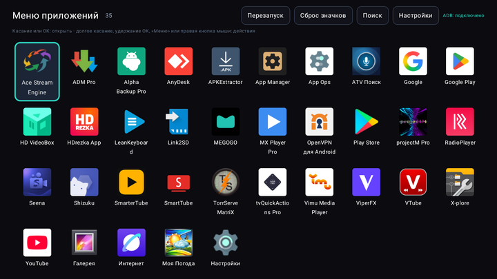
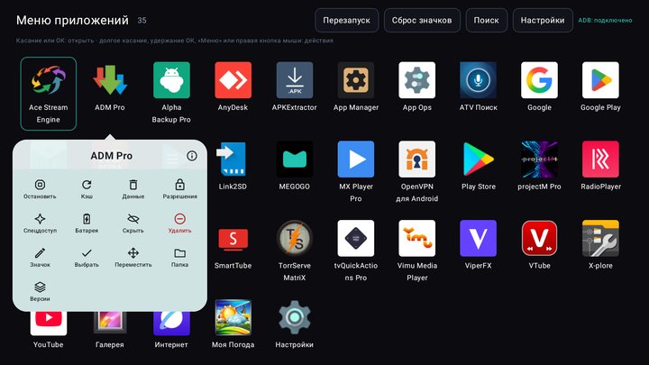
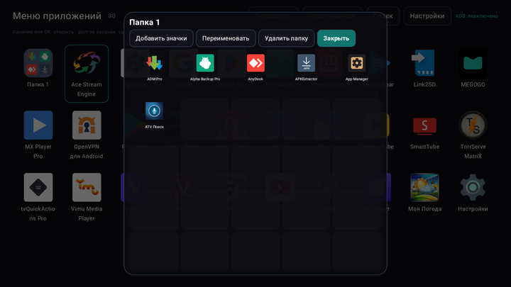
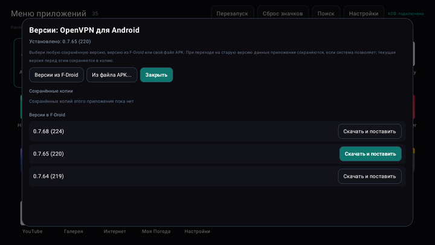
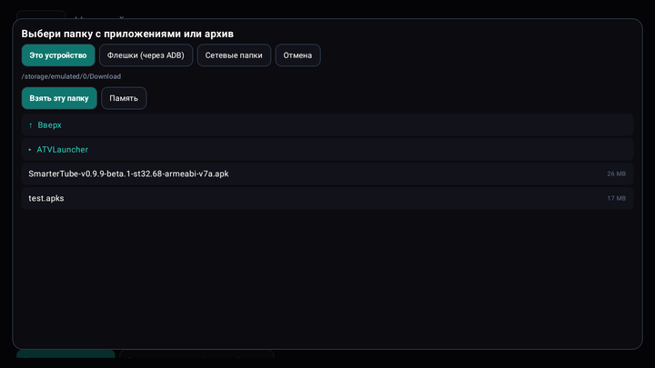
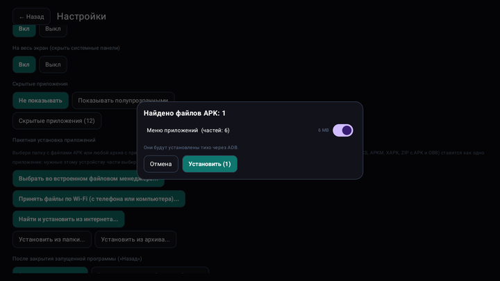
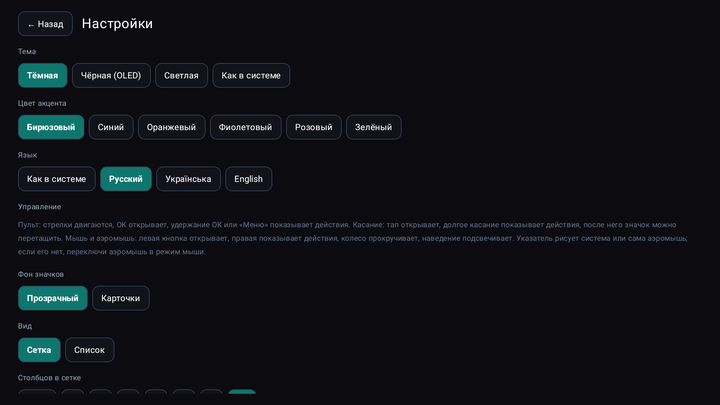
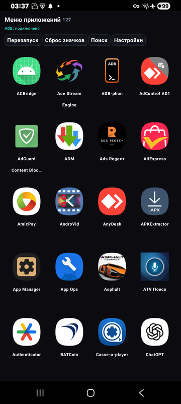
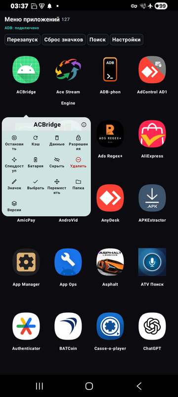

[English](README.md) · [Русский](README.ru.md) · [Українська](README.uk.md)

🌐 Все наши программы: https://drugoj00.github.io/

# Меню приложений

Полноэкранное меню приложений для приставок Android TV, автомагнитол и телефонов: пульт, касание, мышь и аэромышь. Долгое нажатие на значок: остановить, кэш, данные, права, папки и любая версия приложения. Без рекламы.

Меню приложений заменяет штатный список приложений большой сеткой для пульта и для касания. В нём есть то, чего не хватает штатным лаунчерам: карточка действий на каждом значке, как в One UI, папки, пакетная установка и удаление, копии перед удалением и установка любой версии, в том числе более старой.

⭐ Если программа полезна, поставьте звезду этому репозиторию: это ничего не стоит и помогает другим её найти.

## Скачать

**Версия 1.1.** [AppMenu-1.1.apk](https://github.com/drugoj00/app-menu/releases/latest) (Assets) · [Releases](https://github.com/drugoj00/app-menu/releases)

SHA-256: `2bc5e8f92a47e429d5c0854a2ce3f88714e886a8aaef0fa7d12e5c06e398c608`

## Что нового в 1.1

- Root (Magisk) вместо ADB: если на устройстве есть root (автомагнитола, приставка, телефон), программа работает без компьютера и без отладки — остановка, кэш, данные, права, спецдоступ, тихая установка и удаление, OBB, понижение версии и флешки идут через root. Один раз разрешите root программе в Magisk — дальше она подключается сама. В «Настройки» → «Подключить ADB» есть кнопка «Подключить через root» и переключатель. Без root всё работает по ADB, как раньше. Выбор за вами: переключатель решает, что использовать при запуске, а кнопки подключения ADB переключают на ADB.
- Исправлено: на телефонах Samsung установка по ADB могла добавить второй значок того же приложения (копию в «Двойном приложении»). Теперь приложения ставятся только текущему пользователю.

## Возможности

- **Меню для пульта, касания, мыши и аэромыши.** Полноэкранная сетка: ОК открывает, удержание ОК или кнопка «Меню» показывает действия, касание и мышь работают как обычно (левая кнопка открывает, правая показывает действия, колесо прокручивает). Столбцы, размер значков до очень мелких (на телефоне 5 столбцов), подписи, сортировка (имя, новые, старые, частые, своя), поиск, скрытие, режим списка.
- **Карточка действий на каждом значке.** Как в One UI: остановить, очистить кэш, очистить данные, разрешения, спецдоступ (с автовосстановлением после перезагрузки), батарея, скрыть, удалить, значок, папка, версии. Нужен ADB этого же устройства (см. ниже).
- **Папки.** Перетащи один значок на другой, чтобы получилась папка, перетаскивай значки в неё или добавляй изнутри; переименование и удаление. Окно папки: сетка 5×5.
- **Установка откуда угодно.** APK, пакеты из нескольких частей (APKS, APKM, XAPK, ZIP с APK и OBB: нужные устройству части выбираются сами), из папки или архива (ZIP, 7z, RAR, TAR), из встроенного файлового менеджера, с флешек (через ADB, когда система их не показывает), из сетевых папок (SMB, с поиском в локальной сети), с телефона или компьютера по Wi‑Fi (страница в браузере) и из интернета (F-Droid, GitHub, прямая ссылка). Пакетная установка и пакетное удаление.
- **Копии и любая версия.** Перед удалением приложения его APK сохраняется. Ставь любую сохранённую версию, версию из каталога F-Droid или свой файл, в том числе более старую (текущая версия перед этим сохраняется).
- **Режим лаунчера.** Кнопка «Домой» показывает это меню, второе нажатие открывает родной главный экран, «Назад» из приложения возвращает в меню. Включается и выключается в настройках.
- **Вид и язык.** Тема: тёмная, чёрная (OLED), светлая или как в системе; шесть цветов акцента; русский, украинский и английский; свои значки и наборы значков; копия и восстановление настроек.
- **Простое подключение ADB.** На ТВ-приставках с Android 9 и включённым сетевым ADB подключается само. На Android 11+ нажми «Подключить автоматически»: программа включит беспроводную отладку, прочитает код сопряжения и сопряжётся сама (нужна её служба спецвозможностей, она действует только после твоего нажатия). Android 10 и старше: один раз команда с компьютера, дальше подключается само.
- **Бесплатно.** Без рекламы, исходный код открыт.

## Скриншоты

## Быстрый старт

1. Скачайте AppMenu-1.1.apk и установите его (если Android спросит, разрешите установку из этого источника). Значок «Меню приложений» появится в списке приложений (на ТВ-приставке в Leanback-лаунчере).
2. Откройте: приложения запускаются по ОК или касанию, долгое нажатие (удержание ОК или кнопка «Меню») открывает карточку действий. Чтобы пользоваться им вместо штатного меню, включите «Режим лаунчера» в настройках.
3. Для действий над другими приложениями подключите ADB: «Настройки» → «Подключить ADB». ТВ-приставки с Android 9 и сетевым ADB подключаются сами. Android 11+: один раз включите службу «Меню приложений» в спецвозможностях и нажмите «Подключить автоматически». Android 10 и старше: один раз выполните adb tcpip 5555 с компьютера (после перезагрузки повторить).

## Требования

Android 6.0 и новее (ARMv7, ARM64, x86). ADB (или root с Magisk) этого же устройства нужен только для действий над другими приложениями (остановка, кэш, данные, права, спецдоступ, тихая установка и удаление, OBB на Android 11+, понижение версии); меню, папки, сортировка и запуск работают без него. Проверено на ТВ-приставках с Android 9, 11 и 12, Samsung S9 (Android 10) и A14 (Android 15).

## Ограничения и предупреждения

- Действия над другими приложениями требуют отладки по ADB этого же устройства или root (Magisk). Меню приложений работает локально и никуда ничего не отправляет; сетевые запросы только те, которые вы сами запускаете (поиск в F-Droid и GitHub, введённая ссылка).
- Автоподключение ADB на Android 11+ использует службу спецвозможностей. Она читает только окна системных настроек и действует три минуты после нажатия «Подключить автоматически». Проверено на Samsung One UI; на других прошивках пункты настроек могут называться иначе, тогда используйте ручной способ.
- Настоящий Wi‑Fi Direct не используется: файлы принимаются через страницу в браузере в той же сети или через точку доступа телефона. Файлы OBB на Android 11 и новее копируются только через ADB.
- Системные приложения не удаляются. В Google Play программы нет: скачивайте APK здесь; Android может предупредить о неизвестном источнике.
- Проверено на Android 9, 10, 11, 12 и 15. На Android 13 и 14 и прошивках других производителей пока не проверялось, отзывы приветствуются. Известно: копии Samsung Dual Messenger отображаются отдельными значками.

## На чём сделана

Kotlin и Jetpack Compose; ADB-клиент libadb-android (MuntashirAkon, GPL-3.0 или Apache-2.0), Conscrypt, Apache Commons Compress, XZ for Java, junrar, jcifs-ng (LGPL-2.1). Программа независимая и не связана с Google. Лицензия GPL-3.0.

## Новости и помощь

- Telegram: [t.me/PhoneInWindowSound](https://t.me/PhoneInWindowSound)

## Поддержать проект

Программа бесплатная. Если она вам полезна, можно поддержать разработку банковской картой, Google Pay или USDT. Для USDT только сеть TRON (TRC20): монеты, отправленные по другой сети, теряются.

- Картой или Google Pay (от 50 грн): https://secure.wayforpay.com/button/bba92579a4647
- USDT (TRON TRC20): `TXk32CLkwJryTqhmkw6urcM5CacJgPsSpJ`
