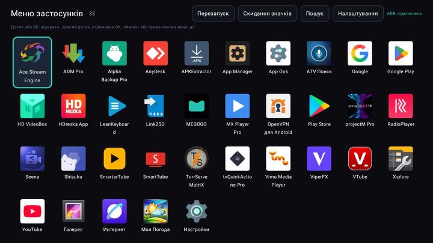
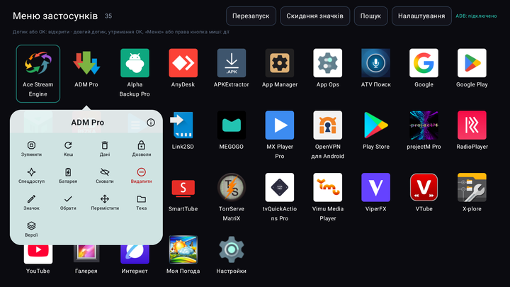
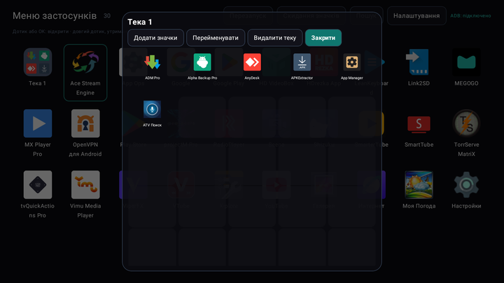
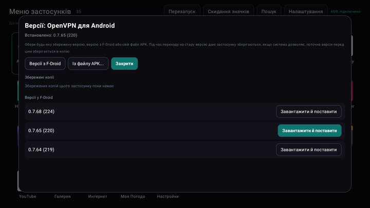
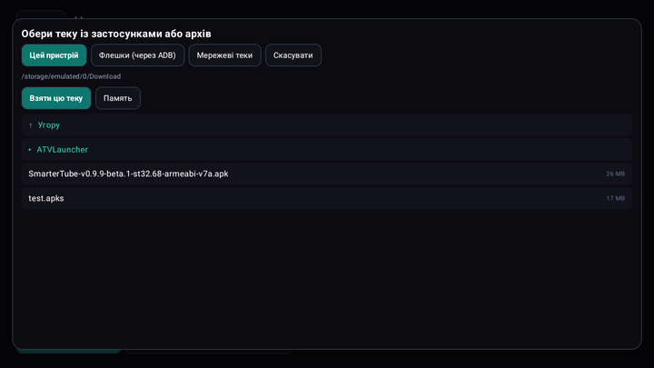
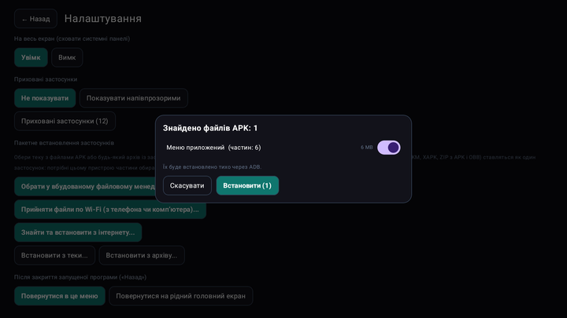
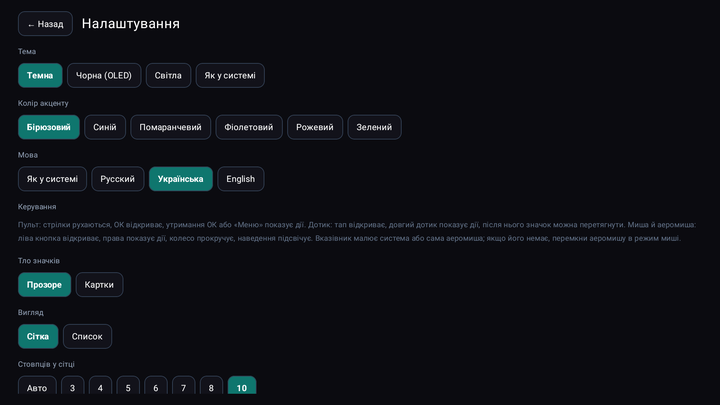
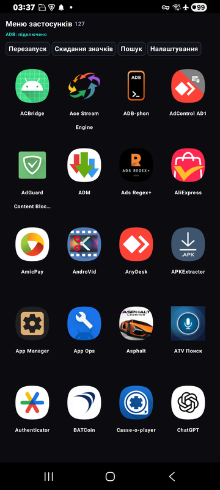
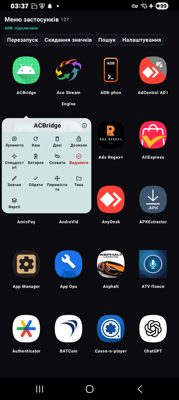

[English](README.md) · [Русский](README.ru.md) · [Українська](README.uk.md)

🌐 Усі наші програми: https://drugoj00.github.io/

# Меню застосунків

Повноекранне меню застосунків для приставок Android TV, автомагнітол і телефонів: пульт, дотик, миша й аеромиша. Довге натискання на значок: зупинити, кеш, дані, дозволи, теки й будь-яка версія застосунку. Без реклами.

Меню застосунків замінює штатний список застосунків великою сіткою для пульта й дотику. У ньому є те, чого бракує штатним лаунчерам: картка дій на кожному значку, як в One UI, теки, пакетне встановлення й видалення, копії перед видаленням і встановлення будь-якої версії, зокрема старішої.

⭐ Якщо програма корисна, поставте зірку цьому репозиторію: це нічого не коштує й допомагає іншим її знайти.

## Завантажити

**Версія 1.0.** [AppMenu-1.0.apk](https://github.com/drugoj00/app-menu/releases/latest) (Assets) · [Releases](https://github.com/drugoj00/app-menu/releases)

SHA-256: `ef577610709bcb517ce2d9665e5f41389315bb92b8ca1b16197bccbcb2f8f449`

## Можливості

- **Меню для пульта, дотику, миші й аеромиші.** Повноекранна сітка: ОК відкриває, утримання ОК або кнопка «Меню» показує дії, дотик і миша працюють як зазвичай (ліва кнопка відкриває, права показує дії, колесо прокручує). Стовпці, розмір значків до дуже дрібних (на телефоні 5 стовпців), підписи, сортування (ім’я, нові, старі, часті, своє), пошук, приховування, режим списку.
- **Картка дій на кожному значку.** Як в One UI: зупинити, очистити кеш, очистити дані, дозволи, спецдоступ (з автовідновленням після перезавантаження), батарея, приховати, видалити, значок, тека, версії. Потрібен ADB цього ж пристрою (див. нижче).
- **Теки.** Перетягни один значок на інший, щоб утворилась тека, перетягуй значки до неї або додавай зсередини; перейменування й видалення. Вікно теки: сітка 5×5.
- **Встановлення звідки завгодно.** APK, пакети з кількох частин (APKS, APKM, XAPK, ZIP з APK і OBB: потрібні пристрою частини обираються самі), з теки або архіву (ZIP, 7z, RAR, TAR), із вбудованого файлового менеджера, з флешок (через ADB, коли система їх не показує), з мережевих тек (SMB, з пошуком у локальній мережі), з телефона чи комп’ютера по Wi‑Fi (сторінка в браузері) та з інтернету (F-Droid, GitHub, пряме посилання). Пакетне встановлення й пакетне видалення.
- **Копії та будь-яка версія.** Перед видаленням застосунку його APK зберігається. Став будь-яку збережену версію, версію з каталогу F-Droid або свій файл, зокрема старішу (поточна версія перед цим зберігається).
- **Режим лаунчера.** Кнопка «Додому» показує це меню, друге натискання відкриває рідний головний екран, «Назад» із застосунку повертає до меню. Вмикається й вимикається в налаштуваннях.
- **Вигляд і мова.** Тема: темна, чорна (OLED), світла або як у системі; шість кольорів акценту; українська, російська й англійська; власні значки та набори значків; копія й відновлення налаштувань.
- **Просте підключення ADB.** На ТВ-приставках з Android 9 і ввімкненим мережевим ADB підключається саме. На Android 11+ натисни «Підключити автоматично»: програма ввімкне бездротове налагодження, прочитає код сполучення й сполучиться сама (потрібна її служба спецможливостей, вона діє лише після твого натискання). Android 10 і старіші: один раз команда з комп’ютера, далі підключається саме.
- **Безкоштовно.** Без реклами, відкритий код.

## Скриншоти

## Швидкий старт

1. Завантажте AppMenu-1.0.apk і встановіть його (якщо Android запитає, дозвольте встановлення з цього джерела). Значок «Меню застосунків» з’явиться у списку застосунків (на ТВ-приставці в Leanback-лаунчері).
2. Відкрийте: застосунки запускаються за ОК або дотиком, довге натискання (утримання ОК або кнопка «Меню») відкриває картку дій. Щоб користуватись ним замість штатного меню, увімкніть «Режим лаунчера» в налаштуваннях.
3. Для дій над іншими застосунками підключіть ADB: «Налаштування» → «Підключити ADB». ТВ-приставки з Android 9 і мережевим ADB підключаються самі. Android 11+: один раз увімкніть службу «Меню застосунків» у спецможливостях і натисніть «Підключити автоматично». Android 10 і старіші: один раз виконайте adb tcpip 5555 з комп’ютера (після перезавантаження повторити).

## Вимоги

Android 6.0 і новіше (ARMv7, ARM64, x86). ADB цього ж пристрою потрібен лише для дій над іншими застосунками (зупинка, кеш, дані, дозволи, спецдоступ, тихе встановлення й видалення, OBB на Android 11+, пониження версії); меню, теки, сортування й запуск працюють без нього. Перевірено на ТВ-приставках з Android 9, 11 і 12, Samsung S9 (Android 10) та A14 (Android 15).

## Обмеження та попередження

- Дії над іншими застосунками потребують налагодження по ADB цього ж пристрою. Меню застосунків працює локально й нічого нікуди не надсилає; мережеві запити лише ті, які ви самі запускаєте (пошук у F-Droid і GitHub, введене посилання).
- Автопідключення ADB на Android 11+ використовує службу спецможливостей. Вона читає лише вікна системних налаштувань і діє три хвилини після натискання «Підключити автоматично». Перевірено на Samsung One UI; на інших прошивках пункти налаштувань можуть називатися інакше, тоді використовуйте ручний спосіб.
- Справжній Wi‑Fi Direct не використовується: файли приймаються через сторінку в браузері в тій самій мережі або через точку доступу телефона. Файли OBB на Android 11 і новіше копіюються лише через ADB.
- Системні застосунки не видаляються. У Google Play програми немає: завантажуйте APK тут; Android може попередити про невідоме джерело.
- Перевірено на Android 9, 10, 11, 12 і 15. На Android 13 і 14 та прошивках інших виробників поки не перевірялося, відгуки вітаються. Відомо: копії Samsung Dual Messenger відображаються окремими значками.

## На чому зроблена

Kotlin і Jetpack Compose; ADB-клієнт libadb-android (MuntashirAkon, GPL-3.0 або Apache-2.0), Conscrypt, Apache Commons Compress, XZ for Java, junrar, jcifs-ng (LGPL-2.1). Програма незалежна й не пов’язана з Google. Ліцензія GPL-3.0.

## Новини та допомога

- Telegram: [t.me/PhoneInWindowSound](https://t.me/PhoneInWindowSound)

## Підтримати проєкт

Програма безкоштовна. Якщо вона вам корисна, можна підтримати розробку банківською карткою, Google Pay або USDT. Для USDT лише мережа TRON (TRC20): монети, надіслані іншою мережею, втрачаються.

- Карткою або Google Pay (від 50 грн): https://secure.wayforpay.com/button/bba92579a4647
- USDT (TRON TRC20): `TXk32CLkwJryTqhmkw6urcM5CacJgPsSpJ`
